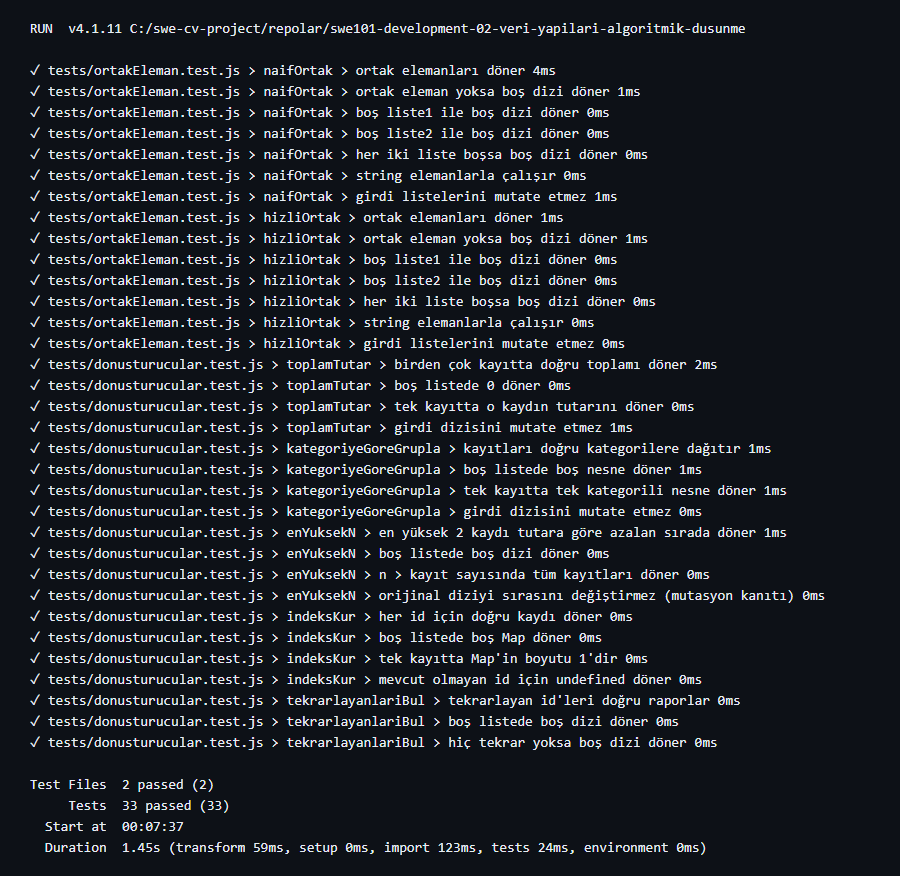

# SWE101 — Veri Yapıları ve Algoritmik Düşünme

25 kayıtlık sipariş verisi üzerinde çalışan 5 saf dönüştürme fonksiyonu ve AI'ın yazdığı O(n×m) kodun Set ile O(n+m)'e iyileştirilmesi.



## Kurulum

```bash
npm install
```

## Testleri Çalıştır

```bash
npm test
```

Çıktı: **33 test, tümü geçmeli.**

## Performans Ölçümü

```bash
node src/olcum.js
```

10.000 elemanlı iki listede `naifOrtak` vs `hizliOrtak` süresini karşılaştırır.

---

## Perde 1 — Dönüştürme Fonksiyonları

`src/donusturucular.js` içindeki 5 saf fonksiyon:

| Fonksiyon               | Ne yapar?                              |
|-------------------------|----------------------------------------|
| `toplamTutar(kayitlar)` | Tüm kayıtların tutar toplamı (reduce)  |
| `kategoriyeGoreGrupla`  | Kategori → kayıt listesi eşlemesi      |
| `enYuksekN(kayitlar,n)` | Tutara göre ilk N kayıt (mutasyonsuz)  |
| `indeksKur(kayitlar)`   | id → kayıt Map'i                       |
| `tekrarlayanlariBul`    | Birden çok geçen id'leri raporlar      |

**Tüm fonksiyonlar girdisini değiştirmez** — `toplamTutar`, `kategoriyeGoreGrupla` ve `enYuksekN` için mutasyon testi mevcuttur.

Örnek veri seti: `src/veri.js` (25 sipariş kaydı, bir kasıtlı tekrarlayan id içerir).

---

## Perde 2 — AI Kodunu Değerlendirme

`src/ortakEleman.js` iki fonksiyon içerir:

- **`naifOrtak`** — "iki listedeki ortak elemanları bul" kısa promptundan üretilen ilk taslak. O(n×m).
- **`hizliOrtak`** — Set kullanılarak iyileştirilmiş sürüm. O(n+m).

Detaylı eleştiri için → [REVIEW.md](./REVIEW.md)

---

## AI Kullanımı

Bu projede Claude Code ile çalıştım. Testlerin ve bazı fonksiyonların bir kısmını Claude Code yazdı; kalan testlerin neredeyse tamamını onları örnek alarak ben yazdım, öğrenmek için bu şekilde ilerledik. `naifOrtak`'taki tekrarlayan eleman sorununu eleştiri sırasında ben fark ettim, `Set` önerisi Claude Code'dan geldi. Claude Code'un yaptığı her şeyi genel olarak kontrol ettim.

---

## Ne Öğrendim

- `reduce` ile hem toplama hem de gruplama yapılabileceğini gördüm; her kullanımda birikimli değerin ne olduğunu açıkça düşünmek gerekiyor.
- `slice()` + `sort()` zinciri immutability için kritik — `sort()` orijinal diziyi değiştiriyor, önce kopyalamak şart.
- AI'ın kısa/muğlak prompta verdiği ilk taslak "çalışan ama eksik" oluyor. Edge case'leri (tekrarlayan eleman, boş liste) belirtmezsen AI da belirtmiyor.
- Big-O analizi soyut görünüyor ama `console.time` ölçümü onu somutlaştırdı: O(n²) vs O(n+m) farkı 10K'da ~39 kat olarak gözüktü.
